# MR BOX — los flujos de dinero

Cada camino por el que se mueve un SC, y dónde se valida cada regla.

Convención: **(A)** = paso atómico (una sola operación condicional contra la
base, sin ventana entre leer y escribir). **(L)** = deja fila en el libro mayor
(`BalanceTransaction`).

## El libro mayor

Todo pasa por `wallet.mover()` (`backend/services/wallet/index.js:76`). La
operación es un `findOneAndUpdate` con el chequeo de saldo **adentro del
filtro**, no antes:

```js
if (monto < 0) filtro.balanceSc = { $gte: -monto };
```

Con `new: false` para quedarse con el `balanceBefore` exacto, y dentro de una
transacción de Mongo cuando el despliegue las soporta. Eso es lo que hace que
dos pedidos simultáneos no puedan dejar el saldo en negativo: el segundo no
encuentra documento que cumpla el filtro y falla.

La variante `soloCanjeable: true` agrega al filtro un `$expr` que resta el bono
todavía no jugado, para que ese bono no se pueda sacar.

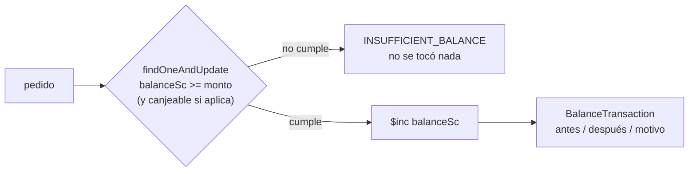

## 1. Depósito en cripto

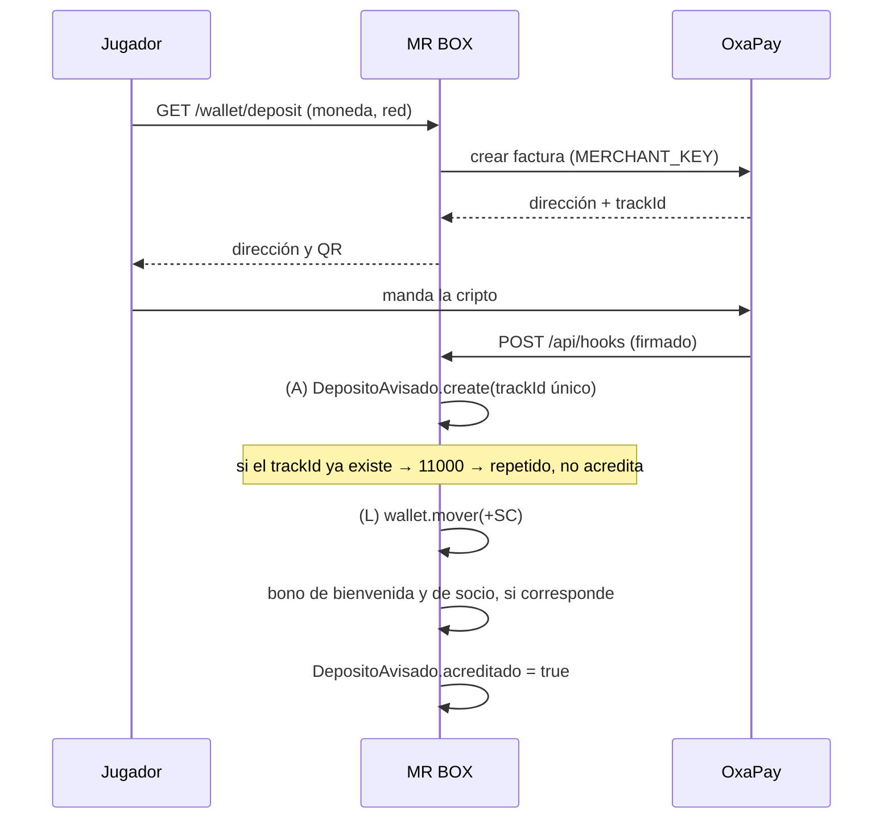

**Dónde se valida qué**

| Regla | Dónde |
|---|---|
| El aviso viene de OxaPay | firma del callback, `routes/wallet/index.js` |
| No acreditar dos veces | `DepositoAvisado.trackId` único, creado **antes** de mover |
| Bono de bienvenida una sola vez | `affiliates.bonoDeCompra` |
| El bono queda con rollover | `User.bonoPendienteSc` + `Settings.vecesAJugarElBono` |

## 2. Abrir una caja

El camino más caliente del sitio. `backend/services/boxes/index.js:84`.

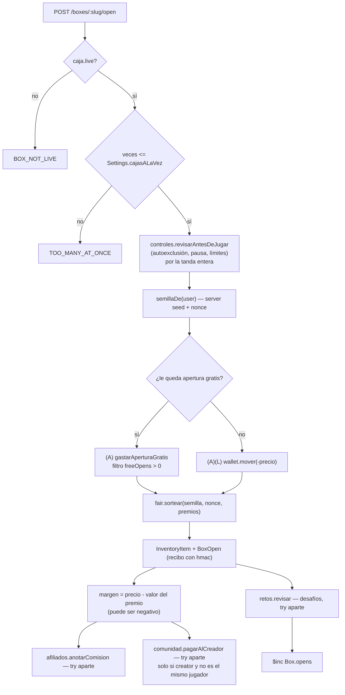

Detalles que importan:

- El cobro y el sorteo son **por apertura**, en un bucle. Una tanda de 4 cobra
  cuatro veces; si la segunda falla, las dos primeras ya ocurrieron. Es
  deliberado: cada apertura es su propio recibo verificable.
- La apertura gratis se gasta con `$gt: 0` en el filtro, así que dos pedidos
  simultáneos no pueden gastar la misma.
- Las comisiones van en `try` propios: que falle pagarle a un socio no puede
  tumbar la apertura de alguien que ya pagó. El costo es que una comisión puede
  perderse en silencio — queda en el registro de errores.
- **No se le paga al creador por abrir su propia caja** (`boxes/index.js:272`),
  que si no sería una forma lenta y segura de sacarle plata a la casa.

## 3. Vender un objeto

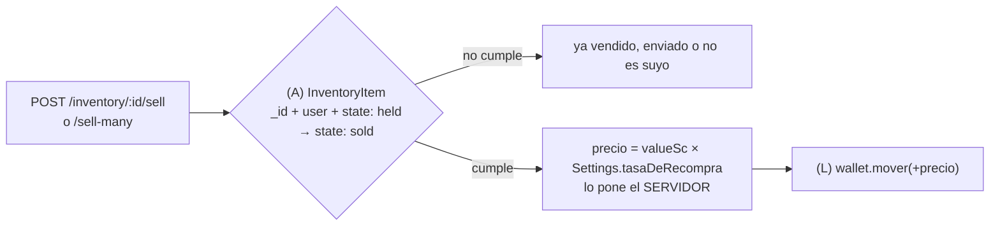

El precio de recompra **nunca** viene del cliente: sale de `Item.valueSc` por la
tasa de `Settings`. El cambio de estado va en el filtro, que es lo que impide
vender dos veces el mismo objeto.

## 4. Pedir el envío de un objeto

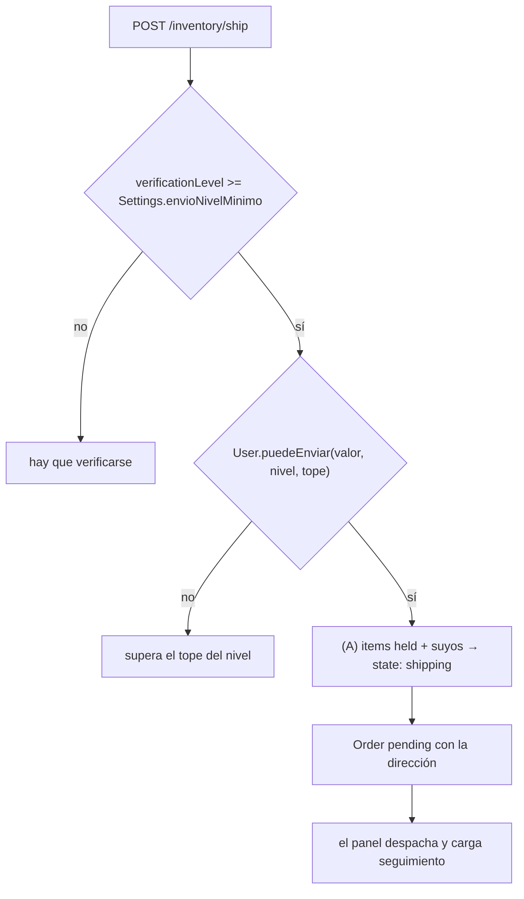

Acá **no se mueve saldo**: el objeto sale del inventario y entra en una orden.
El riesgo no es contable sino de inventario (ver el informe: vender y enviar).

## 5. Canje / retiro

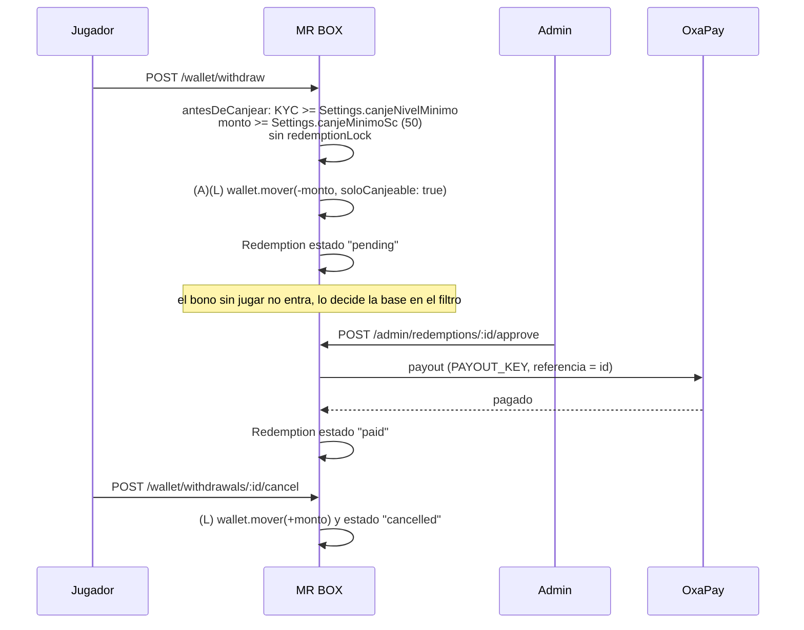

| Regla | Dónde se valida |
|---|---|
| Mínimo 50 SC | `cashier.antesDeCanjear`, `Settings.canjeMinimoSc` |
| Nivel de KYC | `cashier.nivelQuePide(cfg)`, `Settings.canjeNivelMinimo` |
| Aprobación humana | el canje nace en `pending`; nadie paga sin `resolver()` |
| El bono no se puede sacar | `wallet.mover({ soloCanjeable: true })` con `$expr` |
| Cuenta trabada | `User.redemptionLock` |

## 6. La parte del creador (cajas de la comunidad)

Esta es la que tenía el agujero grave, y la que más vale entender.

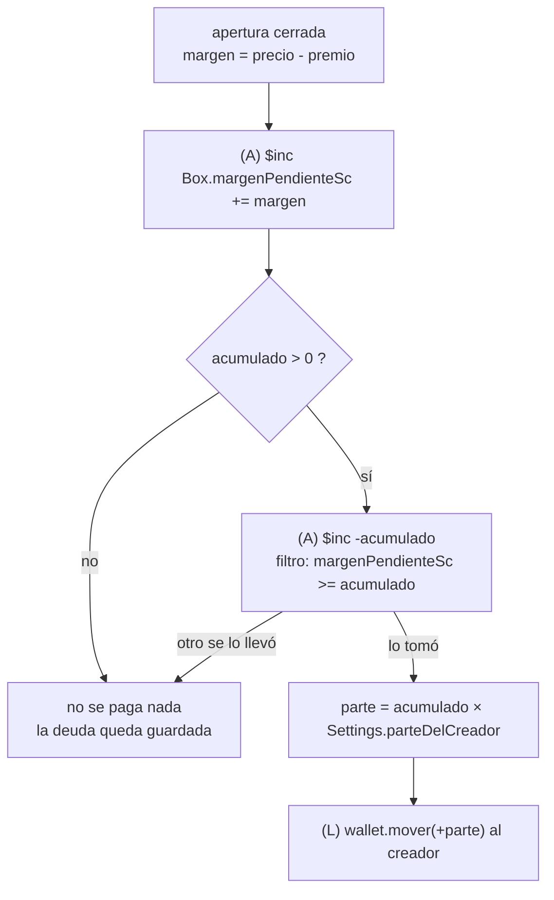

**La comisión es sobre el margen de la casa, no sobre el precio de la caja.**
Medido en vivo sobre la caja `prueba-comision`: precio SC 3,87, retorno 91,99 %,
margen por apertura SC 0,32, el creador cobró SC 0,16 — la mitad del margen —
y SC 0 en la apertura donde el premio superó al precio.

El acumulador `margenPendienteSc` es lo que arrastra las pérdidas: una apertura
que le costó plata a la casa se descuenta de las ganancias siguientes antes de
volver a pagar. Sin eso, una caja de varianza alta pagaba comisión en las
aperturas buenas y nada en las malas, y la casa terminaba en negativo.

## 7. La comisión del socio (afiliados)

Mismo patrón, en `affiliates.anotarComision`:

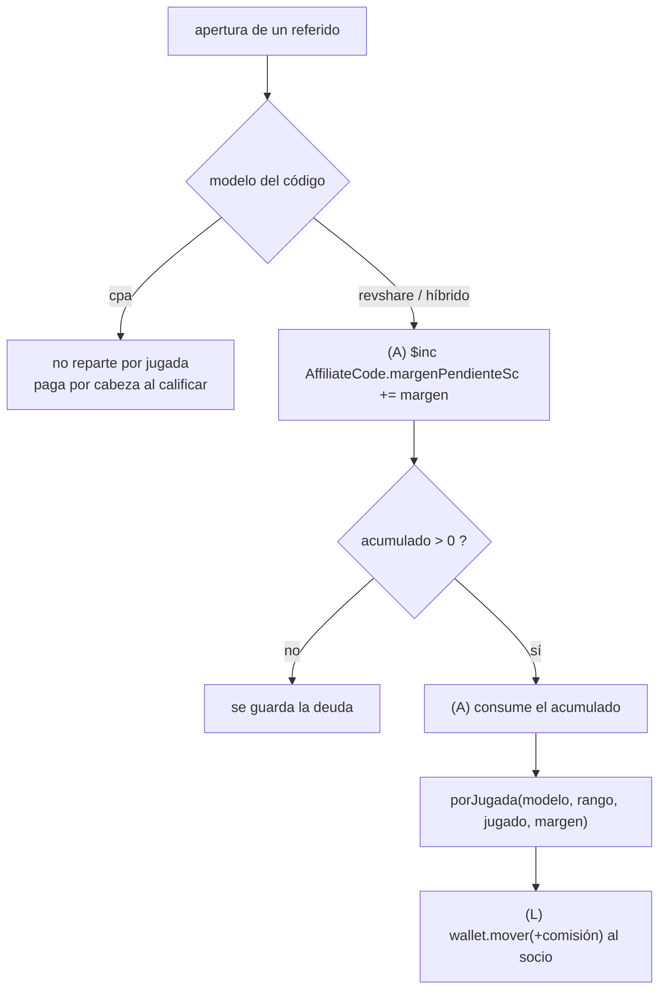

El CPA va por otro lado: `mirarCalificacion` marca la conversión, `senalesDe`
le pone banderas de riesgo, y `liberarCalificados` (el reloj de cada hora) paga
**solo las que no tienen señales**. Las que las tienen esperan a una persona.

## 8. Rakeback VIP

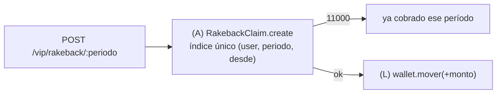

La fila se crea **antes** de mover la plata: es el mismo patrón de idempotencia
que el depósito y el código promocional.

## 9. Código promocional

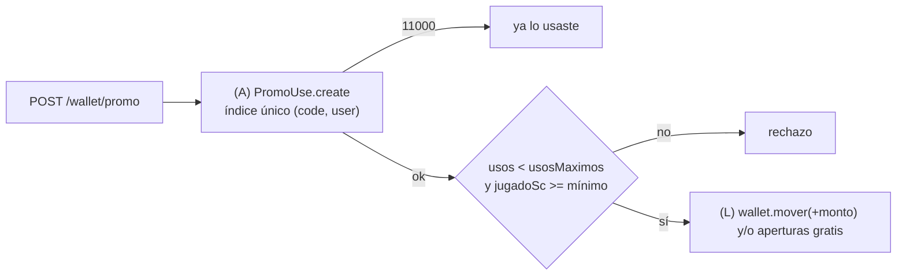

## 10. Carreras

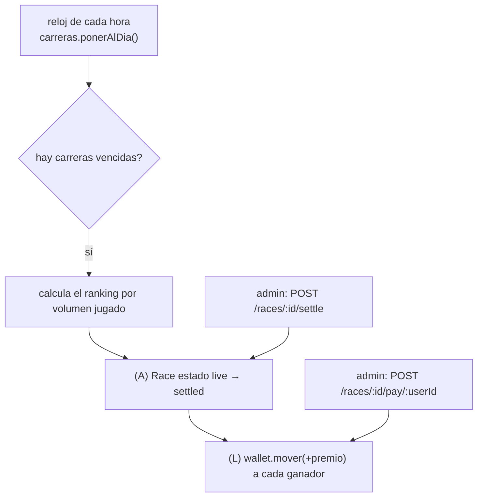

Es el único camino que mueve plata sin pedido HTTP de por medio, junto con
`liberarCalificados`.

## Dónde entra plata y dónde sale

| Entra | Sale |
|---|---|
| Depósito en cripto (OxaPay) | Canje aprobado (payout de OxaPay) |
| Bono de bienvenida | Envío de un objeto físico (sale valor, no SC) |
| Código promocional | |
| Premio de caja (del pozo de la casa al jugador) | Apertura de caja (del jugador a la casa) |
| Venta de un objeto | |
| Rakeback, premio de carrera, desafío | |
| Comisión de socio, parte del creador | |
| Ajuste del panel | Ajuste del panel |

Los dos únicos caminos por los que sale valor **fuera** del sistema son el canje
aprobado y el envío físico. Los dos exigen KYC y los dos pasan por una persona.
